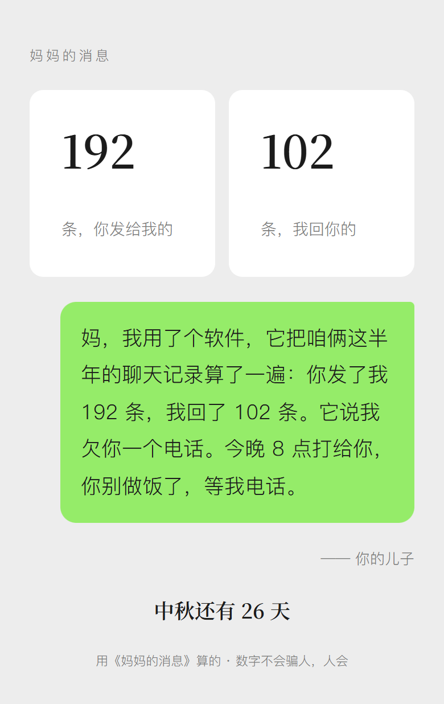
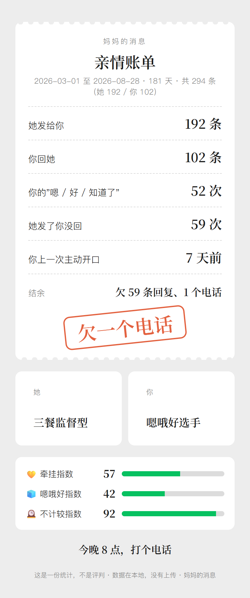
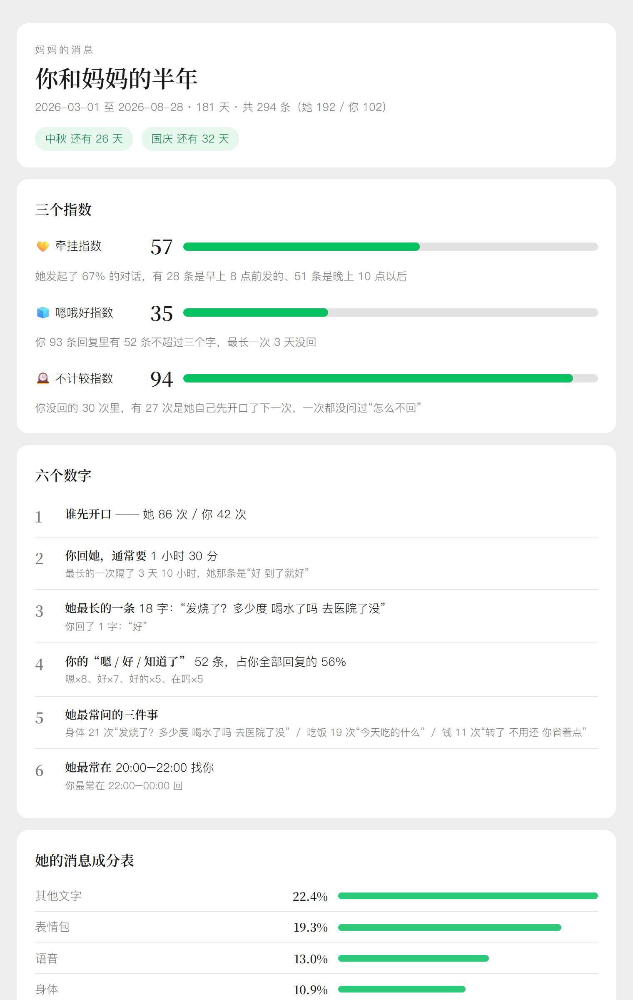

<div align="center">

# 妈妈的消息 · mama-message

**你觉得你和你妈关系挺好的？** 把你们的聊天截图丢给 AI，它给你算一遍。

一份报告、两张卡片、一句可以直接发给她的话。<br>
不是心理学分析，妈妈不需要依恋类型。

[](./LICENSE)
[](./scripts)
[](#先说隐私)
[](./tests)
[](./SKILL.md)

&nbsp;&nbsp;


<sub>模拟数据，没有任何真实的人。左边那张是整个产品的出口。</sub>

</div>

```
💛 牵挂指数    57 ██████░░░░  她发起了 67% 的对话，有 28 条是早上 8 点前发的
🧊 嗯哦好指数  42 ████░░░░░░  你 93 条回复里有 52 条不超过三个字，最长一次 3 天没回
🕰️ 不计较指数  92 █████████░  你没回的 59 次里，有 51 次是她自己先开口了下一次

她：三餐监督型 🍚 ——"吃饭了吗""今天吃的什么""别老吃外卖"，她问吃饭 19 次，只有 3 次是在饭点
你：嗯哦好选手 🧊 ——"嗯"8 次、"好"7 次、"好的"5 次，没有一条超过两个字
综合评级：欠一个电话 📞
```

---

## 先说隐私

- **只吃截图。** 不解密微信数据库，不要密码，不碰你手机。
- **不联网。** 所有脚本只用 Python 标准库，没有任何网络请求；你可以断网跑。
- **不存原文。** 报告只引短句，转账只记次数不记金额，产物都在当前目录，随时删。
- **一键打码。** `python scripts/redact.py 文件 --map "张小明=我" --map "李秀兰=妈妈"`，手机号、身份证、卡号、金额自动打掉。
- 你在哪个 AI 里跑，截图就发给了谁。这一点工具管不了，你自己判断。

---

## 三种用法

### 1 · 不想装任何东西

看 [`prompts/普通用户版.md`](./prompts/普通用户版.md)：三段提示词，复制进豆包 / Kimi / DeepSeek / Claude / ChatGPT，再发截图。报告版、练习版、帮你回版各一段。

### 2 · 用 Claude Code / Codex / Cursor 等支持 Agent Skill 的工具

```bash
git clone https://github.com/BlueSky0329/mama-message ~/.claude/skills/mama-message
```

然后发截图说一句"分析我和我妈的聊天"，或者 `/mama-message`。其他工具把整个文件夹放进对应的 skills 目录即可，SKILL.md 格式通用。

已经有导出文件（留痕 / WeChatMsg / 她不一样的 messages.json / 微信 txt）的：

```bash
python scripts/parse_export.py 导出文件 --her 记录里的名字 --call 妈妈 --out messages.json
python scripts/validate.py messages.json        # 查格式、顺序、重复，打印条数和时间范围
python scripts/stats.py messages.json --out stats.json --her-birthday 10-20 --my-birthday 06-03
# AI 读 stats.json 写 narrative.json，然后：
python scripts/render.py stats.json narrative.json --out reports/
```

### 3 · 在浏览器里跑（不用装 Python）

`web/index.html` 用 [Pyodide](https://pyodide.org) 在浏览器里跑同一套脚本，记录不离开浏览器。本地：仓库根目录 `python -m http.server 8000`，打开 http://localhost:8000/web/ 。放进导出文件或 AI 转录好的 JSON → 检查 → 算数 → 复制提示词给任意 AI 写文字 → 粘回来 → 报告和两张卡。首次打开从 CDN 下载约 10 MB 的运行时，之后断网也能用。

---

## 报告里有什么

<div align="center">

<br><sub><a href="docs/img/report.png">看完整报告截图</a> · 或直接打开 <a href="examples/reports/mama-message-report.html">examples/reports/mama-message-report.html</a></sub>
</div>

| 模块 | 一句话 |
|---|---|
| 💛🧊🕰️ 三个指数 | 牵挂 / 嗯哦好 / 不计较，每个配一句扎心话，公式公开 |
| 六个数字 | 谁先开口 · 你回她通常要多久 · 她最长的一条你回了几个字 · 你的"嗯好知道了" · 她最常问的三件事 · 她最常在几点找你 |
| 成分表 | 她的消息按吃饭 / 天气 / 回家 / 转发 / 语音 / 表情包配比，像食品配料表 |
| 鉴定结果 | 她是 10 型之一（三餐监督 / 天气预报 / 养生转发 / 查岗 / 钱够不够 / 语音轰炸 / 催婚 / 等你先开口 / 沉默守望 / 新闻联播），你是 6 型之一（嗯哦好选手 / 已读不回 / 秒回三个字 / 深夜忏悔 / 周末选手 / 报喜不报忧），盖一个章：模范子女 → 欠一次回家 |
| 黑话翻译表 | "吃了吗" → "在吗，我想你了"；"你忙吧" → "我等你"。从她真说过的话里挑 |
| 节日记分牌 | 你生日她 00:02 发的；母亲节你发了一个表情包 |
| 她发了，你没回 | 最多 5 条，带日期原文，右下角一个空气泡 |
| 她转给你的 | 她转了 7 篇，6 篇养生，3 篇和你说过的脖子疼有关 |
| 该打电话了 | 🔴 她提自己腰不好你回了四个字 · 🔴 她开始用"打扰你了"收尾 · 🟡 她主动少了 40% · 🟡 你 47 天没主动开口 |
| 两个时区 | 她 7 点，你 23 点，24 小时热力条一眼看出错开；每周消息量她 vs 你 |
| 她其实想说的是 | 120–220 字，每句能指到一条原话，不抒情不说教 |
| 今晚就做的三件事 | 第一件 30 秒能做完 |
| 帮你回 + 三句开场白 | 用你自己的口气写好，复制就能发；打电话不知道第一句说什么的看这里 |
| 亲情账单 | 收款单样式：她发给你 192 条 / 你回 102 条 / 结余：欠 59 条回复、1 个电话 |
| 发给她的一条 | "妈，我用了个软件……它说我欠你一个电话。今晚 8 点打给你。" 这是整个产品的出口 |

### 附加入口

| 说一句 | 得到 |
|---|---|
| "练习模式" / "扮演我妈陪我练" | AI 用她的说话方式跟你聊 10 回合，你回"嗯"当场被标出，最后打分 |
| "和朋友比比" | 对照组：你回朋友 3 分钟，回你妈 4 小时 12 分 |
| "妈和爸都分析一下" | 偏心报告：你回谁更快、晾谁更久、谁更主动找你 |
| "帮我回她" | 只要回复话术和开场白，不出整份报告 |
| "做张卡片" | 亲情账单卡 + 发给她的卡，竖版，截图就能发 |

---

## 数据来源

**推荐用导出文件，不要截图。** 半年的聊天一次拿全，时间戳完整；截图一屏才几条，几十张也只覆盖几百条，还得让 AI 逐张转录。

| 来源 | 怎么给 | 备注 |
|---|---|---|
| **WeFlow** 导出的 JSON / CSV / TXT | `parse_export.py` | 微信 **4.0+**，本地运行，Windows / macOS / Linux。首选 |
| 留痕 MemoTrace / WeChatMsg / PyWxDump | CSV 或 JSON | 微信 **3.x** 走这条 |
| 微信 / QQ 文本导出 txt | `parse_export.py` | 两行式、单行式、带方括号时间都认 |
| 她不一样（she-love-me）的 messages.json | 直接喂 | 已经为她导出过的，换个人再跑一遍 |
| 微信 / QQ / 短信截图 | 直接发给 AI | 只有手机、或用 Mac 时的兜底 |

哪个版本用哪个工具、怎么只导一个人、怎么截最近半年：[`references/export-guide.md`](./references/export-guide.md)。

`examples/` 里是用 `make_sample.py` 生成的**模拟数据**（没有任何真实的人）跑出来的完整产物：`sample-stats.json`、`sample-narrative.json`、`reports/` 下三个 HTML。

---

## 项目结构

```
mama-message/
├── SKILL.md                    # Skill 入口：流程、模式、隐私、自检
├── CLAUDE.md · CHANGELOG.md    # 给 AI 的约束 · 版本记录
├── references/
│   ├── metrics.md              # 每个数字怎么算
│   ├── types.md                # 10 + 6 个类型、五档评级
│   ├── dictionary.md           # 黑话翻译表词典和生成规则
│   ├── writing-rules.md        # 文字规矩、反 AI 黑名单、什么时候要收着
│   ├── report-template.md      # 报告模板、narrative.json 字段
│   ├── practice.md             # 练习模式
│   └── export-guide.md         # 聊天记录怎么拿出来（分平台）
├── scripts/                    # 只用标准库，不联网
│   ├── parse_export.py         # 各种导出 → messages.json
│   ├── validate.py             # 检查 messages.json：格式、时间顺序、重复、金额
│   ├── stats.py                # messages.json → stats.json + 终端摘要
│   ├── render.py               # stats + narrative → 报告和两张卡
│   ├── compare.py              # 对照组 / 偏心报告
│   └── redact.py               # 一键打码
├── assets/                     # report.html · card-bill.html · card-send.html
├── prompts/普通用户版.md        # 复制粘贴版
├── web/index.html              # 浏览器版（Pyodide 跑同一套脚本）
├── examples/                   # 模拟数据和产物
├── docs/img/                   # README 用的截图
├── tests/                      # python -m unittest discover -s tests
└── tools/                      # pack.py 打包 .skill · snapshot.py HTML → PNG
```

### 开发

```bash
python -m unittest discover -s tests                 # 29 个测试，含 golden 测试
python examples/make_sample.py                       # 改了算法要重跑示例
python scripts/stats.py examples/sample-messages.json --out examples/sample-stats.json --today 2026-08-30 --her-birthday 10-20 --my-birthday 06-03
python scripts/render.py examples/sample-stats.json examples/sample-narrative.json --out examples/reports
python tools/snapshot.py                             # 可选：pip install playwright，用本机 Chrome 出 docs/img
python tools/pack.py                                 # 打 mama-message.skill
```

数字由脚本算，文字由 AI 写，`render.py` 合成。改指标要三处同步：`scripts/stats.py`、`references/metrics.md`、`prompts/普通用户版.md`。细则在 [`CLAUDE.md`](./CLAUDE.md)。

---

## 说明

这是一份统计，不是评判。"短回复"不是"敷衍"，"没回"不是"不孝"。评级是个章，不是判决。

记录里有争吵、控制、或者她已经不在了，工具会收着写。如果它没收住，是它的错，不是你的。

## 写在最后

你大概是在一个很普通的晚上刷到这个的。可能刚加完班，可能在等外卖。

她今天大概也发了一条。"吃了吗"或者"降温了"。你看到了，想着等会儿回。

这个工具做的事很简单：把"等会儿"数出来。数出来大概是四个小时，或者三天，或者一个"嗯"。

数字不会让你更爱她，你本来就爱她。数字只是让你看见一件你早就知道、但从来没量过的事。

然后它给你一句话，你可以发出去。把责任推给软件——"它说我欠你一个电话"——这样你就不用先说"我想你了"。

她会笑。她可能会说"什么软件啊，乱七八糟的"。

然后她会等你的电话。她一直在等。

中秋在九月底。

<div align="center"><sub><a href="./LICENSE">MIT License</a></sub></div>
